# GCP Security Operations Pipeline (SecOps Pipeline)

**Real-time security log ingestion and detection pipeline on GCP that catches brute-force logins, off-hours API calls, and IAM privilege-escalation attempts in under 2 seconds, entirely on free tier, provisioned with Terraform.**

   

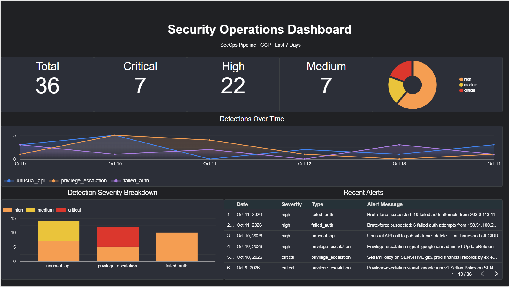

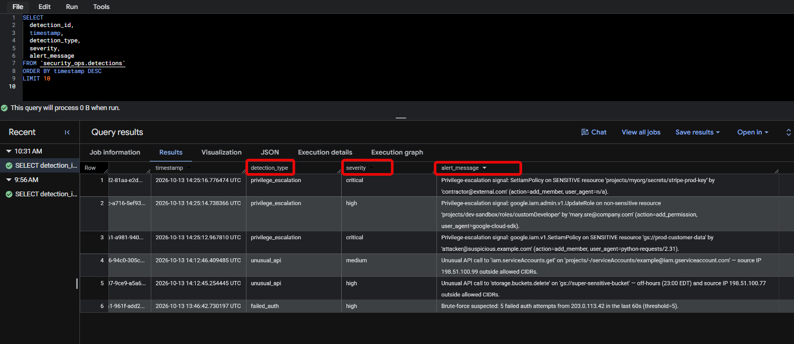

> [ACTION: Decide whether to stack the two hero screenshots above or place them side by side in an HTML table. Stacked is the safest rendering.]

## Executive Summary

**Objective:** build a working security detection pipeline on GCP, end to end, using only free-tier services and Terraform, to demonstrate hands-on cloud security and detection engineering skills. It also serves as preparation for the Terraform Associate certification.

**Skills demonstrated:** GCP log routing (Cloud Logging, Pub/Sub), BigQuery data modeling, Terraform IaC, Python detection logic, IAM least-privilege reasoning, cost control, and debugging real deployment failures.

| Outcome | Result |
|---|---|
| Detections implemented | 3 (brute force, unusual API activity, IAM privilege escalation) |
| Event-to-alert latency | Under 2 seconds observed |
| Infrastructure | 13 Terraform resources in one `terraform apply`, plus 3 Cloud Functions |
| Cost | Free tier, with a $5 budget alert at 50/90/100% |
| Validation | Synthetic end-to-end tests, zero false positives on the benign test event |
| Dashboard | Looker Studio, 7 widgets, 36 detections over 7 days |

**Honest scope note:** events are simulated (GCP audit logs do not emit failed-auth events), and 30 of the 36 dashboard detections are synthetic backfill. See [Known limitations](#known-limitations).

## Table of Contents

- [Executive Summary](#executive-summary)
- [What it does](#what-it-does)
- [Architecture](#architecture)
- [Tech stack](#tech-stack)
- [Quickstart](#quickstart)
- [Ingestion layer](#ingestion-layer)
- [Storage layer](#storage-layer)
- [Detection layer](#detection-layer)
- [Visualization layer](#visualization-layer)
- [Infrastructure as Code](#infrastructure-as-code)
- [End-to-end validation](#end-to-end-validation)
- [Design decisions](#design-decisions)
- [Known limitations](#known-limitations)
- [Debugging stories](#debugging-stories)
- [Teardown](#teardown)
- [License](#license)

## What it does

**Status: complete.** All components are built and tested with synthetic events.

GCP audit, VPC flow, and firewall logs are routed through Cloud Logging sinks into a single Pub/Sub topic. One subscription lands every message in BigQuery as raw JSON. Three Cloud Functions subscribe to the same topic, evaluate detection rules, and write alerts to a curated `detections` table that Looker Studio reads.

Three detection rules:

- **Brute force:** 5+ failed-auth events from the same source IP within a rolling 60 seconds raises HIGH.
- **Unusual API activity:** an API call outside 08:00-18:00 America/New_York, or from outside the allowed CIDR list, raises MEDIUM (one signal) or HIGH (both).
- **Privilege escalation:** any `SetIamPolicy`, `ModifyRole`, `CreateRole`, or `UpdateRole` event raises CRITICAL on sensitive resources, HIGH otherwise.

All three detectors share one severity contract:

| Severity | Business meaning |
|---|---|
| CRITICAL | Page the on-call engineer |
| HIGH | Next-business-day review |
| MEDIUM | Audit log |
| LOW | FYI (reserved) |

## Architecture

```
GCP Audit Logs ─┐
VPC Flow Logs ──┼─► Cloud Logging ─► Log Sinks (3) ─► Pub/Sub topic ─┬─► BQ subscription ─► events (raw)
Firewall Logs ──┘    (filtered)                      "security-logs" │
                                                                      │
                                                                      ├─► failed_auth_detector      ─┐
                                                                      ├─► unusual_api_detector      ─┼─► detections ─► Looker Studio
                                                                      └─► privilege_escalation_detector ─┘
```

The pipeline has four layers:

1. **Ingestion:** Cloud Logging, Log Sinks, Pub/Sub topic.
2. **Landing:** a Pub/Sub BigQuery subscription writes raw JSON to the `events` table.
3. **Detection:** three Cloud Functions subscribed to the topic write to the `detections` table.
4. **Visualization:** a Looker Studio dashboard reads from `detections`.

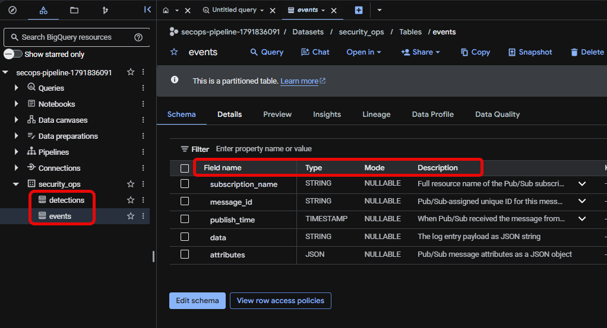

## Tech stack

| Layer | Technology |
|---|---|
| IaC | Terraform (HashiCorp google provider ~> 5.40) |
| Ingestion | Cloud Logging, Log Sinks, Cloud Pub/Sub |
| Storage | BigQuery (US multi-region, day-partitioned) |
| Compute | Cloud Functions Gen 2 (Python 3.11, 256Mi, max_instances=5) |
| Event routing | Eventarc (Pub/Sub to Cloud Function trigger) |
| Visualization | Looker Studio (free tier) |
| Dev environment | Google Cloud Shell |
| Cost control | Cloud Billing Budget ($5, 50/90/100% thresholds) |

## Quickstart

Run everything from Google Cloud Shell. Replace the placeholder values first.

```bash
export PROJECT_ID="secops-pipeline-demo"   # must be globally unique
export BILLING_ACCOUNT="XXXXXX-XXXXXX-XXXXXX"
export REGION="us-central1"
```

> [ACTION: Confirm the region you actually deployed to and update `REGION` above. Also confirm the Terraform variable names in `terraform.tfvars` match the `-var` flags used below, if any.]

**1. Create a dedicated project and link billing**

```bash
gcloud projects create "$PROJECT_ID"
gcloud config set project "$PROJECT_ID"
gcloud billing projects link "$PROJECT_ID" --billing-account="$BILLING_ACCOUNT"
```

**2. Set a $5 budget alert (before writing any code)**

```bash
gcloud billing budgets create \
  --billing-account="$BILLING_ACCOUNT" \
  --display-name="secops-5usd" \
  --budget-amount=5USD \
  --threshold-rule=percent=0.5 \
  --threshold-rule=percent=0.9 \
  --threshold-rule=percent=1.0
```

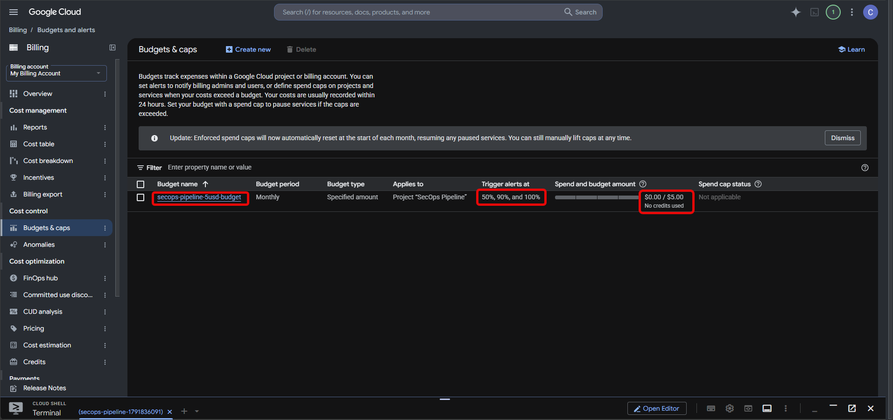

**3. Enable the 10 required APIs**

```bash
gcloud services enable \
  logging.googleapis.com pubsub.googleapis.com bigquery.googleapis.com \
  cloudfunctions.googleapis.com cloudbuild.googleapis.com run.googleapis.com \
  eventarc.googleapis.com artifactregistry.googleapis.com \
  compute.googleapis.com cloudresourcemanager.googleapis.com
```

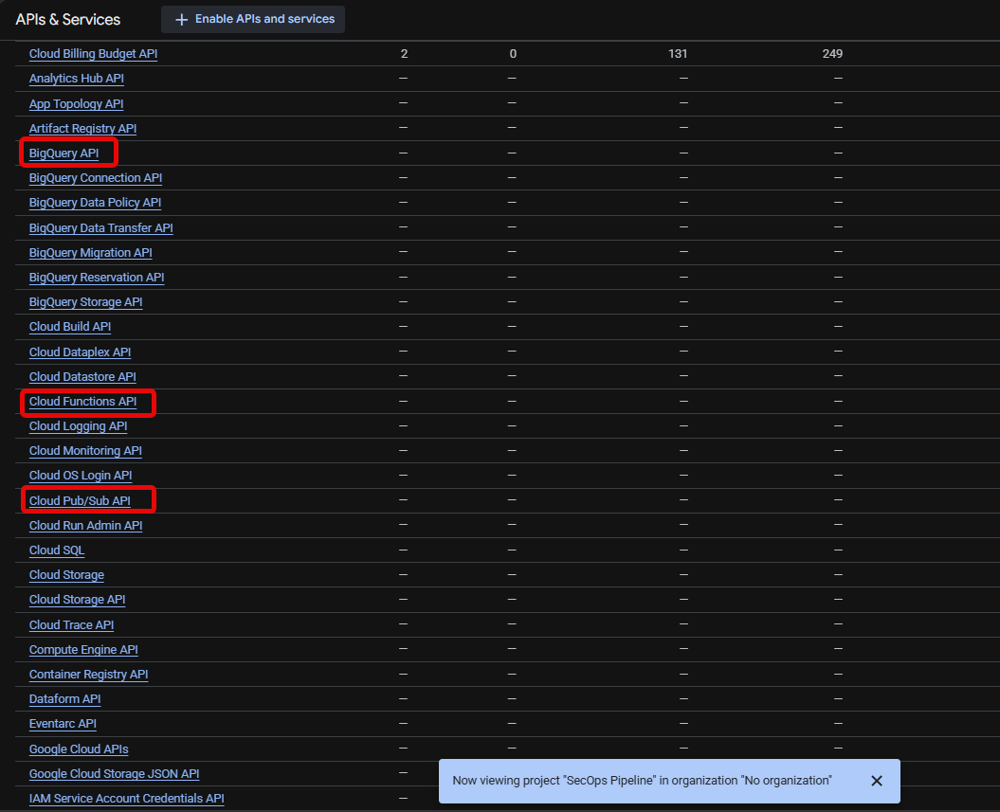

> [ACTION: Your screenshot caption/brief says 9 enabled APIs but the command lists 10. Either re-take the screenshot, or confirm the dashboard simply shows 9 because one is a dependency listed elsewhere.]

**4. Provision infrastructure (13 resources)**

```bash
cd terraform
terraform init
terraform apply
cd ..
```

**5. Grant the Cloud Function service account its BigQuery roles**

```bash
PROJECT_NUMBER=$(gcloud projects describe "$PROJECT_ID" --format='value(projectNumber)')
SA="${PROJECT_NUMBER}-compute@developer.gserviceaccount.com"

bq add-iam-policy-binding \
  --member="serviceAccount:${SA}" --role="roles/bigquery.dataEditor" \
  "${PROJECT_ID}:security_ops"

gcloud projects add-iam-policy-binding "$PROJECT_ID" \
  --member="serviceAccount:${SA}" --role="roles/bigquery.jobUser"
```

**6. Deploy the three Cloud Functions**

```bash
gcloud functions deploy failed_auth_detector \
  --gen2 --runtime=python311 --region="$REGION" \
  --source=functions/failed_auth_detector \
  --entry-point=detect_failed_auth \
  --trigger-topic=security-logs \
  --memory=256Mi --max-instances=5 \
  --set-env-vars=FAILED_AUTH_THRESHOLD=5,WINDOW_SECONDS=60

gcloud functions deploy unusual_api_detector \
  --gen2 --runtime=python311 --region="$REGION" \
  --source=functions/unusual_api_detector \
  --entry-point=detect_unusual_api \
  --trigger-topic=security-logs \
  --memory=256Mi --max-instances=5

gcloud functions deploy privilege_escalation_detector \
  --gen2 --runtime=python311 --region="$REGION" \
  --source=functions/privilege_escalation_detector \
  --entry-point=detect_privilege_escalation \
  --trigger-topic=security-logs \
  --memory=256Mi --max-instances=5 \
  --env-vars-file=functions/privilege_escalation_detector/env.yaml
```

> [ACTION: Verify these commands against what you actually ran (flags, any `--set-env-vars` or `--env-vars-file` for `unusual_api_detector`, and the `--service-account` if you set one). A stranger will copy-paste this block, so it must match your working deploy.]

**7. Fire synthetic events**

```bash
gcloud pubsub topics publish security-logs \
  --message='{"event_type":"failed_auth","source_ip":"203.0.113.42"}'
```

> [ACTION: Replace this payload with the exact JSON shape your detectors parse (field names must match `main.py`). Add the loop that sends 6 failed-auth events and the unusual_api / privilege_escalation payloads from your validation run.]

**8. Connect Looker Studio**

Create a new data source in Looker Studio, choose the BigQuery connector, and select `security_ops.detections`.

**9. Tear down when finished**

```bash
./teardown.sh --nuke-project
```

## Ingestion layer

Three Cloud Logging sinks (audit, VPC flow, firewall) route filtered logs to a single Pub/Sub topic named `security-logs`. Each sink is created with `unique_writer_identity = true`, and Terraform explicitly grants each sink's writer identity `roles/pubsub.publisher` on the topic through three `google_pubsub_topic_iam_member` resources. Omitting that grant is a common cause of logs silently never arriving.

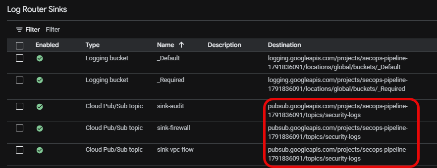

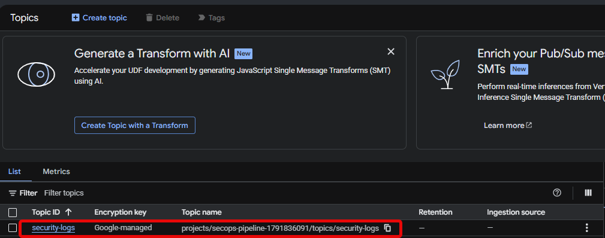

## Storage layer

A Pub/Sub BigQuery subscription (`security-logs-to-bq`, `write_metadata = true`) writes every message into the `events` table with no custom code. The Pub/Sub managed service account is granted `roles/bigquery.dataEditor` and `roles/bigquery.metadataViewer` at project level. Both tables are day-partitioned in the `security_ops` dataset (US multi-region).

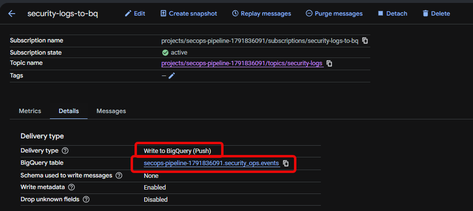

**`events`: raw landing zone**

| Field | Type | Mode | Purpose |
|---|---|---|---|
| subscription_name | STRING | NULLABLE | Pub/Sub subscription that delivered the message |
| message_id | STRING | NULLABLE | Pub/Sub message ID (idempotency key) |
| publish_time | TIMESTAMP | NULLABLE | Partition key |
| data | STRING | NULLABLE | Raw log entry as JSON |
| attributes | JSON | NULLABLE | Pub/Sub message attributes |

**`detections`: curated, OCSF-aligned alerts**

| Field | Type | Mode | Purpose |
|---|---|---|---|
| detection_id | STRING | REQUIRED | UUID5 deterministic hash (dedup key) |
| timestamp | TIMESTAMP | REQUIRED | When the detector fired, UTC (partition key) |
| detection_type | STRING | REQUIRED | failed_auth / unusual_api / privilege_escalation |
| severity | STRING | REQUIRED | low / medium / high / critical |
| raw_event_json | STRING | NULLABLE | Source Pub/Sub message |
| alert_message | STRING | REQUIRED | Human-readable alert |

## Detection layer

Each detector is a Cloud Functions Gen 2 function (Python 3.11) triggered through Eventarc from the `security-logs` topic. All use deterministic UUID5 detection IDs, because Pub/Sub delivers at least once.

### 1. `failed_auth_detector`

- **Rule:** 5+ failed-auth events from the same source IP within a rolling 60-second window raises HIGH.
- **State store:** BigQuery. The function queries `events` for the last 60 seconds, filtered by source IP and grouped via `JSON_VALUE()` on the `data` column. The data already lands there through the BQ subscription, so state costs nothing extra. Cloud Functions are stateless, and Redis or Firestore would be over-engineered at this scale.
- **Idempotency:** UUID5 from `(ip + minute-bucket)` collapses repeat firings.
- **Config:** `FAILED_AUTH_THRESHOLD` (default 5), `WINDOW_SECONDS` (default 60).

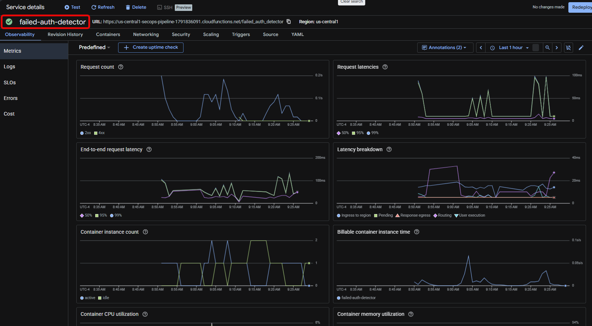

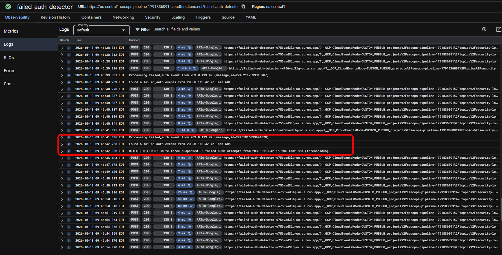

### 2. `unusual_api_detector`

- **Rule:** fires when an API call is outside 08:00-18:00 America/New_York, or from an IP outside the allowed CIDR list.
- **Severity:** MEDIUM for one signal, HIGH for both. Dynamic tiering avoids flat-severity alert fatigue.
- **State store:** none. It is a fully stateless per-event rule.
- **Idempotency:** UUID5 from `(ip + action + minute-bucket)`.
- **Config:** `BUSINESS_TZ` (America/New_York), `BUSINESS_HOUR_START` (8), `BUSINESS_HOUR_END` (18), `ALLOWED_CIDRS` (default RFC 1918 ranges).
- **Stdlib:** `zoneinfo` for DST-safe time handling and `ipaddress` for CIDR membership.

![unusual_api_detector logs showing DETECTION FIRED [HIGH] and [MEDIUM]](screenshots/09-function-unusual-api-deployed.PNG)

### 3. `privilege_escalation_detector`

- **Rule:** fires on any event_type containing `SetIamPolicy`, `ModifyRole`, `CreateRole`, or `UpdateRole`.
- **Severity:** CRITICAL if the target resource is sensitive, HIGH otherwise.
- **Sensitivity:** tag-based first (`tags.sensitive == true`), then prefix match against a configurable list such as `gs://prod-` or `projects/-/serviceAccounts/prod-`.
- **State store:** none.
- **Idempotency:** UUID5 from `(event_type + resource + actor + minute-bucket)`.
- **Config:** `SENSITIVE_PREFIXES` (semicolon-separated).
- **Design note:** in production, sensitivity would come from GCP resource tags enforced via Org Policy. The detector would only read tags, not define sensitivity.

![privilege_escalation_detector logs showing [CRITICAL] and [HIGH] lines](screenshots/10-function-privilege-escalation-deployed.PNG)

## Visualization layer

A Looker Studio dashboard (dark theme, 7 widgets) reads directly from `security_ops.detections`. It currently shows 36 detections across 7 days.

> [ACTION: List the 7 widgets here (e.g., one bullet per widget with chart type and what it answers). They were not in the brief, so I left them out rather than guess.]

## Infrastructure as Code

A single `terraform apply` creates 13 resources:

- 1 Pub/Sub topic (`security-logs`)
- 3 Cloud Logging sinks with `unique_writer_identity = true`
- 3 Pub/Sub IAM members granting each sink `roles/pubsub.publisher`
- 1 BigQuery dataset (`security_ops`)
- 2 day-partitioned BigQuery tables (`events`, `detections`)
- 2 project IAM members granting the Pub/Sub managed service account `roles/bigquery.dataEditor` and `roles/bigquery.metadataViewer`
- 1 Pub/Sub BigQuery subscription (`security-logs-to-bq`)

The three Cloud Functions are deployed separately with `gcloud functions deploy`.


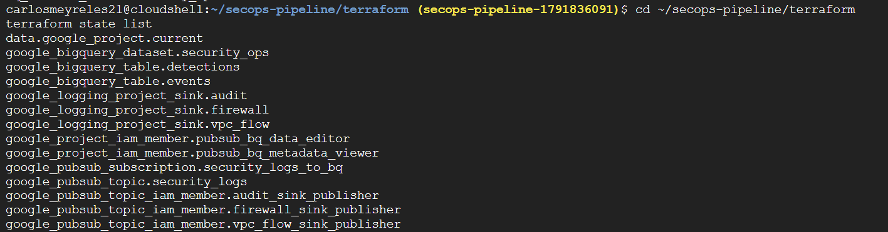

> [ACTION: The state screenshot shows 14 entries but the apply created 13. If the extra entry is the `data "google_project"` lookup, add one sentence saying so here; interviewers will notice the mismatch.]

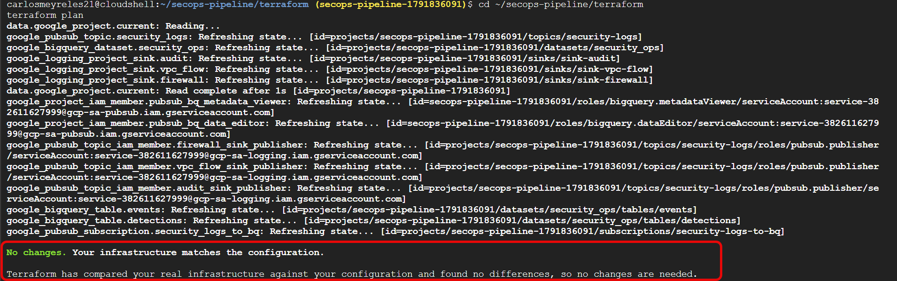

> [ACTION: Decide whether to explain why the functions are not in Terraform (a deliberate choice or just a scoping decision). Be ready to answer this in an interview.]

## End-to-end validation

Tested with synthetic Pub/Sub publishes using documentation-range IPs: `203.0.113.0/24` (RFC 5737 TEST-NET-3) and `198.51.100.0/24` (TEST-NET-2).

| Detector | Input | Result |
|---|---|---|
| failed_auth | 6 failed-auth events from `203.0.113.42` | 1 HIGH: "Brute-force suspected: 5 failed auth attempts from 203.0.113.42 in the last 60s (threshold=5)" |
| unusual_api | 2 events (off-hours + off-CIDR; business-hours + off-CIDR) | 1 HIGH + 1 MEDIUM, with correctly worded alerts |
| privilege_escalation | 4 events (2 on sensitive, 1 on dev-sandbox, 1 benign `storage.get`) | 2 CRITICAL + 1 HIGH, zero false positives |

Observed end-to-end latency, from event publish to detection row written, was **under 2 seconds**.

> [ACTION: The brief also says the failed-auth detection appeared "within ~90 seconds" of the test run. Clarify the difference (e.g., 90 seconds was the time for the BQ subscription to land the events the detector queries, versus under 2 seconds for the stateless detectors). Without this, the latency claim looks inconsistent.]

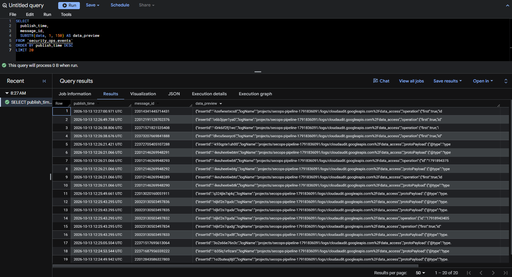

## Design decisions

- **Dedicated GCP project:** contains blast radius and makes teardown a single command.
- **$5 budget alert before any code:** a cost tripwire from day one.
- **Explicit sink-to-Pub/Sub IAM grants in Terraform:** prevents the most common silent-failure bug in GCP log routing.
- **`google_pubsub_topic_iam_member` over `_iam_binding`:** additive grants cannot wipe other principals' access.
- **BigQuery subscription with `write_metadata = true`:** zero-code ingestion that keeps message metadata.
- **Day-partitioning on both tables:** cheap recent-window queries.
- **OCSF-aligned `detections` schema:** a vendor-neutral event standard.
- **BigQuery as the brute-force state store:** avoids provisioning Redis or Firestore for data already landing there.
- **Dynamic severity in `unusual_api_detector`:** avoids flat-severity alert fatigue.
- **UUID5 deterministic IDs:** Pub/Sub is at-least-once, so duplicate deliveries must collapse.
- **Parameterized BigQuery queries:** safe against SQL injection.
- **`max_instances=5` per function:** a cost guardrail on runaway invocations.

## Known limitations

1. **Failed-auth events are simulated.** GCP Cloud Audit logs do not emit `failed_auth` event types; those come from an identity provider (Workspace, Okta, a custom app). This project simulates the stream with synthetic Pub/Sub publishes. A real deployment would parse fields like `protoPayload.authenticationInfo.principalEmail`.
2. **`events` holds raw JSON, not OCSF rows.** Audit, VPC flow, and firewall formats are heterogeneous. The right production pattern is raw, then transformer, then curated; here, normalization lives inside each detector.
3. **Sensitive-resource detection uses prefix matching.** Production would use GCP resource tags enforced via Org Policy.
4. **Default Compute service account.** The functions run as an identity with `roles/editor` project-wide, which is more than needed. Production would use a dedicated per-function service account with narrow IAM.
5. **The 36 dashboard detections are synthetic.** 6 came from real test publishes and 30 from a backfill SQL insert across the past week, to validate dashboard rendering.
6. **No alerting out of the dashboard.** A next step would be a Pub/Sub notification channel or a Monitoring alert policy.
7. **Looker Studio queries BigQuery live on refresh.** Production would use BI Engine for caching.

## Debugging stories

**Cloud Resource Manager API is not enabled by default.** Terraform's `data "google_project"` lookup failed with a 403. `gcloud` auto-enables helper APIs on demand, but Terraform does not. The fix was to enable `cloudresourcemanager.googleapis.com` explicitly, which is now step 3 of the Quickstart.

**BigQuery needs two permissions to run a query.** The Cloud Function could reach BigQuery, but queries failed. `roles/editor` grants dataset access, yet running a query also requires `roles/bigquery.jobUser` at project scope. This is why Quickstart step 5 grants both roles.

**Container healthcheck failure on `unusual_api_detector`.** The deploy crashed at module load. `gcloud --set-env-vars` uses commas as its delimiter, which collided with the commas in the CIDR list. Cloud Build logs showed `ValueError: '10.0.0.0/8;192.168.0.0/16;172.16.0.0/12' does not appear to be an IPv4 or IPv6 network`. I fixed it with a parser in Python that accepts both separators. The third function used `--env-vars-file=env.yaml` from the start, which is the production-safe pattern because it sidesteps shell escaping.

**Gen 2 functions appear in the Cloud Run console.** This is not a bug. Gen 2 Cloud Functions are Cloud Run services with Eventarc wiring underneath, and GCP has consolidated them into the Cloud Run page, which reflects Google's architectural direction.

## Teardown

```bash
./teardown.sh                  # resource-by-resource, idempotent (uses || true)
./teardown.sh --nuke-project   # deletes the entire project (30-day recovery window)
```

The script deletes in reverse dependency order: functions, sinks, subscriptions, topic, dataset, budget.

> **Verify:** GCP billing lags about 24 hours, so 48 hours after teardown, confirm $0 is accruing under Billing → Reports.

## License

MIT. See [LICENSE](LICENSE).
